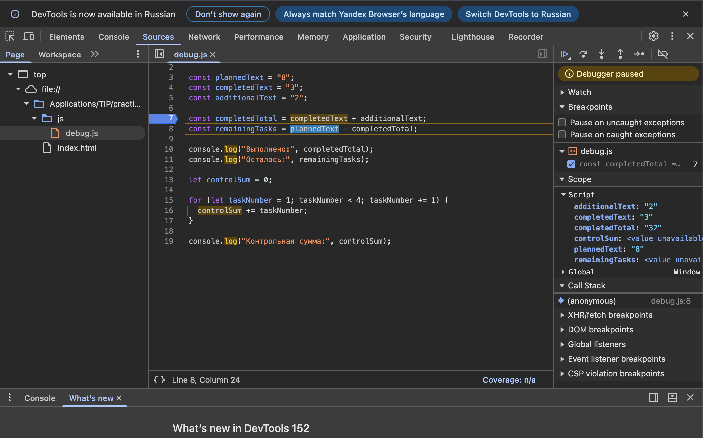

# Практическая работа № 1

**Тема:** Подготовка окружения и первые программы на JavaScript

## 1. Автор и вариант

- **Студент:** Марковский Андрей Андреевич
- **Группа:** ЭФБО-02-25
- **Номер в журнале:** 17
- **Вариант:** 1 (`((17 - 1) % 8) + 1 = 1`; `totalTasks = 12`, `completedTasks = 5`, `dailyLimit = 3`)

## 2. Окружение

- **ОС:** macOS
- **Node.js:** `v24.22.3`
- **npm:** `11.19.1`
- **Git:** `git version 2.54.0 (Apple Git-157)`
- **Браузер:** Яндекс Браузер (Chromium, DevTools 152)

## 3. Инструкция запуска

Команды выполняются из корня репозитория:

```bash
node practice-01/js/hello.js
node practice-01/js/types.js
node practice-01/js/progress.js
node practice-01/js/plan.js
node practice-01/js/debug.js
node practice-01/js/plan-week.js
```

**Запуск в браузере:** открыть `practice-01/index.html`, при необходимости заменить путь в атрибуте `src` тега `<script>` на нужный `.js`-файл, сохранить изменения, перезагрузить страницу и открыть вкладку **Console / Консоль** в DevTools.

## 4. Задание 1. Один файл — две среды выполнения

Файл `practice-01/js/hello.js` запущен в терминале через Node.js (`node practice-01/js/hello.js`) и в браузере через `practice-01/index.html`. В обоих случаях результат вывелся в консоль (в терминал и во вкладку DevTools Console соответственно, а не на саму HTML-страницу).

Различие в последней строке (`typeof document`):
- В **Node.js** выводится `Тип document: undefined`, потому что серверная среда выполнения не создаёт HTML-страницу и не предоставляет браузерный DOM API.
- В **браузере** выводится `Тип document: object`, так как браузер предоставляет глобальный объект `document` для работы со структурой открытой страницы.

## 5. Задание 2. Исследование типов и преобразований

| Выражение | Ожидание до запуска | Фактическое значение | Тип результата | Объяснение |
|---|---|---|---|---|
| `"8" + 2` | `"82"`, `string` | `"82"` | `string` | Оператор `+` со строковым операндом выполняет конкатенацию, преобразуя число `2` в строку `"2"`. |
| `"8" - 2` | `6`, `number` | `6` | `number` | Вычитание определено только для чисел, поэтому строка `"8"` неявно приводится к числу `8`. |
| `Number("8") + 2` | `10`, `number` | `10` | `number` | `Number("8")` явно даёт число `8`, затем выполняется арифметическое сложение `8 + 2`. |
| `"12" > "3"` | `false`, `boolean` | `false` | `boolean` | Строки сравниваются посимвольно (лексикографически): первый символ `"1"` меньше символа `"3"`. |
| `12 === "12"` | `false`, `boolean` | `false` | `boolean` | Строгое равенство не выполняет приведение типов; число `12` и строка `"12"` разных типов. |
| `Number("")` | `0`, `number` | `0` | `number` | Пустая строка (как и строка из пробелов) при преобразовании через `Number()` даёт `0`, а не `NaN`. |
| `Number("text")` | `NaN`, `number` | `NaN` | `number` | Текст нельзя преобразовать в корректное число — возвращается `NaN`, который в JS имеет тип `number`. |
| `Boolean("false")` | `true`, `boolean` | `true` | `boolean` | `Boolean()` оценивает не смысл слова, а непустоту строки; любая непустая строка приводится к `true`. |
| `typeof null` | `"object"`, `string` | `"object"` | `string` | Историческая особенность JS: `typeof null` возвращает строку `"object"`; тип самого результата `typeof` всегда `"string"`. |
| `typeof NaN` | `"number"`, `string` | `"number"` | `string` | `NaN` относится к числовому типу, поэтому `typeof NaN` возвращает строку `"number"`, а тип этого результата — `"string"`. |

## 6. Задания 3 и 4. Таблицы проверок

### Задание 3 (`progress.js`)

| Проверка | Входные данные (`totalTasks`, `completedTasks`) | Ожидаемый результат | Фактический результат | Итог |
|---|---|---|---|---|
| Вариант 1 (обычный случай) | `12`, `5` | Осталось 7; прогресс 41.7%; статус «В работе» | Осталось 7; прогресс 41.7%; статус «В работе» | Пройдено |
| Отсутствие задач | `0`, `0` | Сообщение «Задач пока нет», без расчёта процента | `Задач пока нет` | Пройдено |
| Граничный (0 выполнено) | `5`, `0` | Осталось 5; прогресс 0.0%; статус «Не начато» | Осталось 5; прогресс 0.0%; статус «Не начато» | Пройдено |
| Граничный (все выполнены) | `5`, `5` | Осталось 0; прогресс 100.0%; статус «Завершено» | Осталось 0; прогресс 100.0%; статус «Завершено» | Пройдено |
| Выполнено больше общего | `5`, `6` | Ошибка: выполнено больше, чем существует | `Ошибка: выполненных задач не может быть больше общего количества.` | Пройдено |
| Отрицательное число | `-1`, `0` | Ошибка: отрицательное количество | `Ошибка: количество задач не может быть отрицательным.` | Пройдено |
| Дробное число | `5`, `2.5` | Ошибка: дробное количество | `Ошибка: количество задач должно быть целым числом.` | Пройдено |
| Строка вместо числа | `"5"`, `2` | Ошибка: вместо числа передана строка | `Ошибка: количество задач должно быть числом.` | Пройдено |
| Превышение границы | `1001`, `0` | Ошибка: превышена верхняя граница | `Ошибка: общее количество задач не должно превышать 1000.` | Пройдено |
| `NaN` | `NaN`, `0` | Ошибка: недопустимое числовое значение | `Ошибка: количество задач должно быть конечным числом.` | Пройдено |

### Задание 4 (`plan.js`)

| Проверка | Входные данные (`totalTasks`, `completedTasks`, `dailyLimit`) | Ожидаемый результат | Фактический результат | Итог |
|---|---|---|---|---|
| Вариант 1 (обычный случай) | `12`, `5`, `3` | 3 дня; в последний день 1 задача | День 1: 3 (ост. 4), День 2: 3 (ост. 1), День 3: 1 (ост. 0); `Потребуется дней: 3` | Пройдено |
| Кратный остаток | `10`, `4`, `3` | 2 дня по 3 задачи | День 1: 3 (ост. 3), День 2: 3 (ост. 0); `Потребуется дней: 2` | Пройдено |
| Лимит больше остатка | `5`, `3`, `10` | 1 день, выполнено 2 задачи | День 1: 2 (ост. 0); `Потребуется дней: 1` | Пройдено |
| Все задачи выполнены | `5`, `5`, `2` | 0 дней; цикл не выполняется | `Все задачи уже выполнены. Потребуется дней: 0` | Пройдено |
| Задач нет | `0`, `0`, `2` | 0 дней; цикл не выполняется | `Все задачи уже выполнены. Потребуется дней: 0` | Пройдено |
| Нулевой лимит | `5`, `2`, `0` | Ошибка; цикл не запускается | `Ошибка: дневная норма должна быть в диапазоне от 1 до 1000.` | Пройдено |
| Дробный лимит | `5`, `2`, `1.5` | Ошибка: дробная норма | `Ошибка: входные данные должны быть целыми числами.` | Пройдено |
| Некорректное число задач | `5`, `6`, `2` | Ошибка: выполнено больше общего | `Ошибка: выполненных задач не может быть больше общего количества.` | Пройдено |
| Лимит строкой | `5`, `2`, `"2"` | Ошибка: норма задана строкой | `Ошибка: все входные данные должны быть числами.` | Пройдено |
| Превышение лимита | `5`, `2`, `1001` | Ошибка: превышена верхняя граница нормы | `Ошибка: дневная норма должна быть в диапазоне от 1 до 1000.` | Пройдено |

## 7. Задание 5. Отладка через DevTools

**Фактический вывод исходной версии (с ошибками):**

```text
Выполнено: 32
Осталось: -24
Контрольная сумма: 6
```

**Фактический вывод после исправления:**

```text
Выполнено: 5
Осталось: 3
Контрольная сумма: 10
```

| Ошибка | Что наблюдалось | Причина | Исправление | Результат после исправления |
|---|---|---|---|---|
| Обработка количества задач | `completedTotal` равно `"32"`, `remainingTasks` равно `-24` | Исходные значения были строками; оператор `+` склеил `"3"` и `"2"` в `"32"`, а `-` преобразовал строки к числам и вычислил `8 - 32` | Явно преобразовал строки в числа через `Number()` до сложения и вычитания | `Выполнено: 5`, `Осталось: 3` |
| Граница цикла | `controlSum` равна `6` вместо `10` | Условие `taskNumber < 4` завершало цикл на значении `3`, не включая четвёртую задачу | Изменил условие на `taskNumber <= 4` | `Контрольная сумма: 10` |



## 8. Дополнительное задание (Вариант Б — план с выходными днями)

Реализовано в отдельном файле `practice-01/js/plan-week.js`. Первый календарный день считается понедельником; 6-й и 7-й дни каждой недели (суббота и воскресенье) пропускаются без выполнения задач, при этом выходные не добавляются после завершения последней задачи.

| Проверка | Входные данные (`totalTasks`, `completedTasks`, `dailyLimit`) | Ожидаемый результат | Фактический результат | Итог |
|---|---|---|---|---|
| Контрольный случай | `6`, `0`, `1` | 6 рабочих дней, 8 календарных дней | Рабочих дней: 6; календарных дней: 8 (дни 6 и 7 — выходные) | Пройдено |
| Завершение ровно в пятницу | `5`, `0`, `1` | 5 рабочих дней, 5 календарных дней (выходные не добавляются) | Рабочих дней: 5; календарных дней: 5 | Пройдено |
| Все задачи выполнены | `5`, `5`, `2` | 0 рабочих и 0 календарных дней | Рабочих дней: 0; календарных дней: 0 | Пройдено |
| Переход через двое выходных | `12`, `0`, `1` | 12 рабочих дней, 16 календарных дней | Рабочих дней: 12; календарных дней: 16 | Пройдено |

## 9. Вывод

В ходе работы подготовлено окружение для разработки на JavaScript (Node.js 24 LTS, npm, Git, DevTools), освоено различие браузерной и серверной сред выполнения, работа с типами данных, строгим режимом, валидацией входных данных, циклами `while`/`for` и пошаговой отладкой через точки останова. Наиболее показательной оказалась ошибка с конкатенацией строк `"3" + "2"` в `debug.js`: программа завершилась без исключения и ошибки компиляции, но выдала неверный расчёт (`32` и `-24`), что подтвердило важность явного преобразования типов и проверки значений в отладчике.