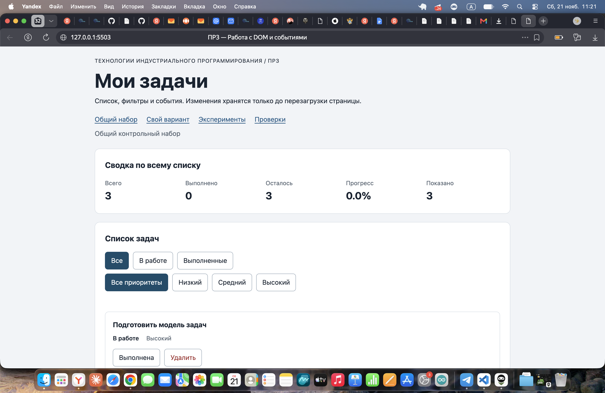

# Практическая работа № 3. Работа с DOM и событиями

## Данные работы

| Поле | Значение |
|---|---|
| Имя | Марковский Андрей Андреевич |
| Группа | ЭФБО-02-25 |
| Вариант из ПР2 | Вариант 1 (номер в журнале 17; «Подготовка учебного проекта») |
| Node.js | `v24.22.3` |
| Браузер | Яндекс Браузер (Chromium, DevTools 152) |
| Операционная система | macOS |

## Запуск

Рабочая папка: `practice-03` внутри личного репозитория.

```bash
npm run check:service
npm start
```

Устанавливать зависимости через `npm install` не требуется.

```text
[http://127.0.0.1:5503/](http://127.0.0.1:5503/)
[http://127.0.0.1:5503/index.html?dataset=variant](http://127.0.0.1:5503/index.html?dataset=variant)
[http://127.0.0.1:5503/examples/dom-events.html](http://127.0.0.1:5503/examples/dom-events.html)
[http://127.0.0.1:5503/checks.html](http://127.0.0.1:5503/checks.html)
```

Остановка сервера: `Ctrl+C`.

## Что перенесено из ПР2

В `practice-03/src/` скопированы собственные проверенные файлы `task-service.js` и `data.js` из `practice-02/src/` (без переноса консольного `main.js`). В `task-service.js` содержатся все 9 чистых функций без обращений к `document`, а в `data.js` — общий контрольный набор `demoTasks` и индивидуальный набор Варианта 1 (`variantNumber = 1`, 6 задач с `id` `11, 23, 37, 41, 58, 64`). Повторная проверка командой `node practice-03/checks/service.checks.js` прошла без ошибок (35 из 35), исправлений не потребовалось.

## Эксперименты

| № | До запуска: прогноз | После запуска: результат | Объяснение |
|---:|---|---|---|
| 1. Отсутствующий элемент и коллекция | `null` и длина `0` | `Отсутствующий элемент: null`; `Пустая коллекция: 0` | `querySelector` возвращает `null` при отсутствии совпадения (обращение к свойствам без проверки вызовет ошибку), а `querySelectorAll` всегда возвращает `NodeList` (при отсутствии элементов его `length === 0`). |
| 2. dataset и числовой id | `"23"` (`string`) и `23` (`number`) | `dataset.taskId: 23 string`; `Числовой id: 23` (`number`) | Значения HTML-атрибутов `data-*` в `dataset` всегда хранятся как строки, поэтому перед передачей в функции ПР2 требуется явное преобразование через `Number()` и проверка `Number.isSafeInteger`. |
| 3. Статический NodeList | `initialItems.length` останется `1`, новый запрос даст `2`, затем `3` | После 1-го нажатия: `Старый NodeList: 1`, `Новый querySelectorAll: 2`; после 2-го: `1` и `3` | `querySelectorAll` возвращает статический снимок элементов на момент вызова и не обновляется автоматически при добавлении новых `<li>` в DOM. |
| 4. Строка с HTML-разметкой | Теги `<strong>` выведутся обычным текстом, без жирного начертания | Заголовок отобразил текст `<strong>Это текст, а не HTML</strong>`, вложенных DOM-элементов нет | Свойство `textContent` вставляет значение строго как текст и не запускает HTML-парсер в отличие от `innerHTML`. |
| 5. Распространение события | 3 записи: захват на `lab-card` (`phase=1`), всплытие на `lab-button` (`phase=3`), всплытие на `lab-card` (`phase=3`); везде `target=lab-label` | `1. phase=1; target=lab-label; currentTarget=lab-card`<br>`2. phase=3; target=lab-label; currentTarget=lab-button`<br>`3. phase=3; target=lab-label; currentTarget=lab-card` | При клике на вложенный `<span id="lab-label">` исходная цель (`event.target`) — именно `span`, поэтому оба родительских обработчика на `lab-button` и `lab-card` получают событие на фазе всплытия (`phase=3`), а обработчик с `{ capture: true }` — на фазе захвата (`phase=1`). |

## Организация кода

- `src/data.js` — экспорт неизменяемых наборов `demoTasks`, `variantTasks` и номера варианта `variantNumber`.
- `src/task-service.js` — чистые функции бизнес-логики из ПР2 (`findTaskById`, `getTaskStats`, `setTaskCompleted`, `removeTask` и др.) без зависимости от DOM.
- `src/task-selectors.js` — вычисление видимой выборки `getVisibleTasks(tasks, filter)` и дополнительного фильтра по приоритету `filterTasksByPriority(tasks, priority)` без мутации входных данных.
- `src/task-view.js` — построение карточки `createTaskElement` (строго через `document.createElement` и `textContent`), перерисовка списка `renderTaskList` через `replaceChildren`, обновление сводки `renderSummary` (через `getTaskStats`) и пустых состояний `renderEmptyState`.
- `src/main.js` — хранение текущего состояния (`currentTasks`, `currentFilter`, `currentPriority`), однократная подписка на события контейнеров (`#task-list`, `#task-filters`, `#priority-filters`), делегированная обработка нажатий, вызов сервиса ПР2, очистка/вывод сообщений об ошибках и восстановление фокуса `restoreTaskFocus`.

Полный список и выбранные фильтры хранятся в `main.js`; события обрабатываются делегированно на контейнерах через `closest` и `contains`; сводка вычисляется в `renderSummary` по полному массиву `currentTasks` через `getTaskStats`.

## Общий сценарий

| Шаг | Видимые id | Всего | Выполнено | Осталось | Прогресс | Показано | Сообщение | Совпало с ожиданием |
|---:|---|---|---|---|---|---|---|---|
| 0 | `[1, 4, 7, 10]` | 4 | 2 | 2 | `50.0%` | 4 | — | Да |
| 1 | `[4, 7]` | 4 | 2 | 2 | `50.0%` | 2 | — | Да |
| 2 | `[7]` | 4 | 3 | 1 | `75.0%` | 1 | — | Да |
| 3 | `[1, 4, 7, 10]` | 4 | 3 | 1 | `75.0%` | 4 | — | Да |
| 4 | `[1, 4, 10]` | 3 | 3 | 0 | `100.0%` | 3 | — | Да |
| 5 | `[]` | 3 | 3 | 0 | `100.0%` | 0 | `Нет задач по выбранному фильтру.` | Да |
| 6 | `[1, 4, 10]` | 3 | 2 | 1 | `66.7%` | 3 | — | Да |
| 7 | `[]` | 0 | 0 | 0 | `0.0%` | 0 | `Список задач пуст.` | Да |

**После перезагрузки:** приложение возвращается к шагу 0 (исходные 4 задачи `[1, 4, 7, 10]`, прогресс `50.0%`), так как хранение состояния между перезагрузками не входит в ПР3.

## Индивидуальный вариант

**Вариант 1 — «Подготовка учебного проекта»** (`?dataset=variant`, 6 исходных задач с `id` `11, 23, 37, 41, 58, 64`, все `completed: false`, приоритеты `high`, `medium`, `low`).

| Этап | Всего | Выполнено | Осталось | Прогресс | Видимые id |
|---|---|---|---|---|---|
| До действий | 6 | 0 | 6 | `0.0%` | `[11, 23, 37, 41, 58, 64]` |
| После переключения 23 | 6 | 1 | 5 | `16.7%` | `[11, 23, 37, 41, 58, 64]` |
| После удаления 37 | 5 | 1 | 4 | `20.0%` | `[11, 23, 41, 58, 64]` |
| Итог, фильтр «В работе» | 5 | 1 | 4 | `20.0%` | `[11, 41, 58, 64]` |
| Итог, фильтр «Выполненные» | 5 | 1 | 4 | `20.0%` | `[23]` |

Приоритеты и названия остальных задач сохранились без изменений.

## Протокол проверки сервиса

Команда: `npm run check:service` (из папки `practice-03`) / `node practice-03/checks/service.checks.js`.

```text
OK: 01. Создание задачи с явным приоритетом
OK: 02. Приоритет по умолчанию
OK: 03. Удаление краевых пробелов без изменения внутренних
OK: 04. Граничные длины названия и положительный безопасный id
OK: 05. Некорректные названия при создании
OK: 06. Некорректные идентификаторы при создании
OK: 07. Все допустимые приоритеты и отклонение недопустимых
OK: 08. Каждый вызов createTask возвращает новый объект
OK: 09. Поиск по id, а не по индексу
OK: 10. Отсутствующая задача и пустой массив при поиске
OK: 11. Поиск не преобразует строковый id в число
OK: 12. Получение невыполненных задач
OK: 13. Пустой список, все выполнены и все не выполнены
OK: 14. Названия в исходном порядке и пустой список
OK: 15. Сводка по общему набору
OK: 16. Сводка по пустому списку
OK: 17. Сводка: ничего не выполнено и выполнено всё
OK: 18. Процент остаётся числом без предварительного округления
OK: 19. Добавление в конец без изменения входного массива
OK: 20. Добавление в пустой список с приоритетом по умолчанию
OK: 21. Повторяющийся id отклоняется
OK: 22. Добавление не обходит проверки createTask
OK: 23. Изменение completed в обе стороны
OK: 24. completed принимает только boolean
OK: 25. Некорректный или отсутствующий id при изменении статуса
OK: 26. Повторная установка статуса создаёт новый результат
OK: 27. Переименование сохраняет остальные поля
OK: 28. Проверки названия при переименовании
OK: 29. Некорректный или отсутствующий id при переименовании
OK: 30. Удаление по id с сохранением порядка
OK: 31. Удаление единственной записи
OK: 32. Некорректный, отсутствующий id и удаление из пустого списка
OK: 33. Входные объекты не изменяются ни одной операцией
OK: 34. Общий сценарий и все промежуточные сводки
OK: 35. Работа с другим набором, без зависимости от demoTasks

Проверок пройдено: 35; не пройдено: 0.
```

## Протокол браузерных проверок

Страница: `http://127.0.0.1:5503/checks.html`.

```text
OK: Фильтр all возвращает новый массив в исходном порядке
OK: Фильтр pending выбирает невыполненные задачи
OK: Фильтр completed выбирает выполненные задачи
OK: Все три фильтра работают с пустым списком
OK: Фильтрация не меняет входные записи и их порядок
OK: Карточка — li.task-card с числовым id в dataset
OK: Статус невыполненной карточки и aria-pressed согласованы
OK: Статус выполненной карточки и aria-pressed согласованы
OK: В карточке две обычные кнопки с вложенными подписями
OK: Все приоритеты отображаются по установленному словарю
OK: Название с разметкой отображается текстом
OK: Отрисовка списка создаёт карточки в исходном порядке
OK: Повторная отрисовка не накапливает карточки
OK: Контейнер списка и его обработчик сохраняются
OK: Отрисовка пустого массива очищает прежние карточки
OK: Сводка считается по всему списку, отдельно выводится Показано
OK: Пустая сводка не содержит NaN и Infinity
OK: Сообщение для полностью пустого списка
OK: Сообщение для пустого результата фильтра
OK: Появление карточек скрывает прежнее пустое состояние
OK: Приложение: начальный набор и сводка
OK: Приложение: фильтр срабатывает по клику на вложенный span
OK: Приложение: активный фильтр отмечен классом и aria-pressed
OK: Приложение: фильтрация не удаляет скрытые задачи
OK: Приложение: переключение по id, а не индексу массива
OK: Приложение: выполненная задача исчезает из фильтра В работе
OK: Приложение: удаление изменяет данные, а не только DOM
OK: Приложение: клик по названию не изменяет данные
OK: Приложение: после перерисовок одно нажатие — одно изменение
OK: Приложение: удаление всех записей и нулевая сводка
OK: Приложение: нет совпадений — не то же самое, что нет задач
OK: Приложение: неизвестный числовой id не меняет данные
OK: Приложение: id 4abc не превращается в 4
OK: Приложение: неизвестное действие игнорируется
OK: Приложение: после изменения сохраняется клавиатурный фокус
OK: Приложение: новая загрузка возвращает исходное состояние

Всего: 36. Пройдено: 36. Ошибок: 0.
```

## Собственные проверки

| № | Исходное состояние и действия | Ожидаемый результат | Фактический результат | Итог |
|---:|---|---|---|---|
| 1 | Граничный случай: удалить задачи `1`, `4`, `7`, оставив единственную задачу `id = 10` (`completed: true`), затем переключить её статус на `false` и обратно | Сводка меняется с `1 / 1 / 0 / 100.0%` на `1 / 0 / 1 / 0.0%` и обратно; карточка не дублируется, статус и `aria-pressed` обновляются согласованно | Сводка корректно обновилась `1 / 0 / 1 / 0.0%` → `1 / 1 / 0 / 100.0%`, в списке осталась 1 карточка `id = 10` | Пройдено |
| 2 | Событие и повторная отрисовка: переключить фильтры `В работе → Выполненные → Все` 3 раза подряд, затем кликнуть по тексту `span.action-label` кнопки «Выполнена» у `id = 4` | Действие выполняется ровно один раз (обработчики не накапливаются при перерисовках), `id = 4` меняет статус на `Выполнена`, прогресс становится `75.0%` | `id = 4` переключилась однократно, сводка `4 / 3 / 1 / 75.0%` | Пройдено |
| 3 | Работа в режиме «Выполненные»: перевести все задачи Варианта 1 (`?dataset=variant`) в статус `В работе`, открыть «Выполненные», затем вернуть «Все» | На фильтре «Выполненные» показано `0`, выводится `Нет задач по выбранному фильтру.`, при возврате на «Все» отображаются все 6 задач | Выведено `Нет задач по выбранному фильтру.`, при возврате на «Все» все 6 задач остались на месте | Пройдено |

## Отладка и клавиатура

- **Отладка в DevTools:** точка останова установлена в `src/main.js` на строке `const rawId = card.dataset.taskId;` внутри `handleTaskListClick`. При клике по тексту кнопки «Выполнена» карточки `id = 4` получены значения:
  - `event.target` — `<span class="action-label">Выполнена</span>`;
  - `event.currentTarget` — `<ul id="task-list" class="task-list">`;
  - `rawId` (`card.dataset.taskId`) — `"4"` (`string`);
  - `id` (`Number(rawId)`) — `4` (`number`);
  - `action` — `"toggle"`;
  - `task` (`findTaskById(currentTasks, 4)`) — объект задачи `id = 4` с `completed: false`;
  - `result` (`setTaskCompleted(currentTasks, 4, true)`) — `{ ok: true, tasks: Array(4) }` с новым массивом и обновлённой записью `id = 4` (`completed: true`).
- **Клавиатура и фокус:** навигация `Tab` проходит по ссылкам, фильтрам и кнопкам карточек с видимой рамкой `:focus-visible`. Активация `Enter` и `Space` вызывает те же обработчики `click`. После переключения статуса в фильтре «Все» фокус сохраняется на кнопке «Выполнена» той же карточки; после удаления задачи или её исчезновения из фильтра «В работе» `restoreTaskFocus` переводит фокус на активную кнопку фильтра.
- **Проверка отказа через Elements:** при временной подмене `data-task-id` на `"777"` выводится сообщение `Задача с id 777 не найдена`, а при `"4abc"` — `Некорректный идентификатор задачи: "4abc"` (частичный разбор не выполняется). Массив `currentTasks` не изменяется; клик по фильтру «Все» восстанавливает актуальные карточки и очищает сообщение.

## Вид приложения



## Дополнительное задание

Выполнен **Вариант А — дополнительный фильтр по приоритету**.

- **Правила поведения:** в `index.html` добавлена отдельная группа кнопок `#priority-filters` («Все приоритеты», «Низкий», «Средний», «Высокий»), не затрагивающая контракт `#task-filters`. В `src/task-selectors.js` добавлена чистая функция `filterTasksByPriority(tasks, priority)`. В `main.js` введено состояние `currentPriority` и обработчик `handlePriorityFilterClick`. Фильтры статуса и приоритета применяются последовательно; общая сводка по-прежнему считается по полному `currentTasks`, а «Показано» — по совместной выборке.
- **Проверки расширения:**
  1. Совместный отбор на общем наборе: «В работе» + «Высокий» → показана 1 задача (`id = 4`), общая сводка остаётся `4 / 2 / 2 / 50.0%`, «Показано» = `1`.
  2. Отсутствие совпадений: «Выполненные» + «Высокий» (при `id = 4` в работе) → список пуст, выводится `Нет задач по выбранному фильтру.`, «Показано» = `0`.
  3. Сохранение выбранного приоритета после действия и сброс: в режиме «Все» + «Низкий» нажать «Выполнена» у `id = 7` — активный приоритет «Низкий» сохраняется, статус карточки обновляется, затем выбор «Все приоритеты» возвращает полный список из 4 задач.

## Вывод

Реализован браузерный интерфейс управления задачами на базе прикладного модуля ПР2 с разделением логики, селекторов, представления и обработки событий. Освоено создание DOM через `createElement` и безопасный текстовый вывод `textContent`, делегирование событий через `closest`/`contains`, работа с `dataset`, доступность (`aria-pressed`, возврат фокуса) и отладка прохождения события в DevTools. Ключевой принцип работы: изменение DOM является следствием изменения данных (`currentTasks` через чистые функции ПР2) и последующей перерисовки `renderApp()`, а не прямой правкой узлов страницы.