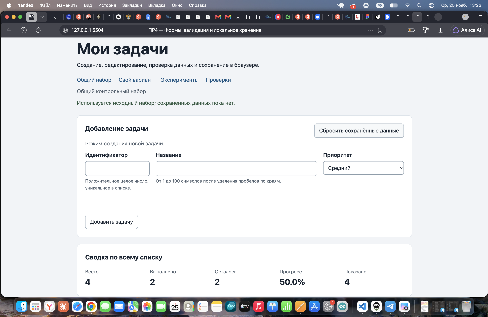

# Практическая работа № 4. Формы, валидация и локальное хранение данных

## Данные работы

| Поле | Значение |
|---|---|
| Имя | Марковский Андрей Андреевич |
| Группа | ЭФБО-02-25 |
| Вариант из ПР2–ПР3 | Вариант 1 (номер в журнале 17; «Подготовка учебного проекта») |
| Node.js | `v24.22.3` |
| Браузер | Яндекс Браузер (Chromium, DevTools 152) |
| Операционная система | macOS |

## Запуск

Рабочая папка: `practice-04` внутри личного репозитория.

```bash
npm test
npm start
```

Устанавливать зависимости через `npm install` не требуется.

```text
[http://127.0.0.1:5504/](http://127.0.0.1:5504/)
[http://127.0.0.1:5504/index.html?dataset=variant](http://127.0.0.1:5504/index.html?dataset=variant)
[http://127.0.0.1:5504/examples/forms-storage.html](http://127.0.0.1:5504/examples/forms-storage.html)
[http://127.0.0.1:5504/checks.html](http://127.0.0.1:5504/checks.html)
```

Остановка сервера: `Ctrl+C`.

## Перенос результата ПР3

Из `practice-03/src/` перенесены проверенные модули данных, прикладной логики, фильтрации и представления. Повторный запуск `npm run check:service` подтвердил работоспособность всех 35 прежних проверок (0 ошибок).

| Файл | Что перенесено или изменено |
|---|---|
| `data.js` | Полностью перенесён из ПР3: общий `demoTasks` и Вариант 1 (`variantNumber = 1`, 6 задач с `id` `11, 23, 37, 41, 58, 64`). |
| `task-service.js` | Перенесены 9 чистых функций ПР2–ПР3; добавлена `updateTask(tasks, id, title, priority)` с валидацией полей и сохранением `completed`. |
| `task-selectors.js` | Перенесена функция `getVisibleTasks(tasks, filter)` для режимов `all`, `pending`, `completed`. |
| `task-view.js` | Перенесены `createTaskElement`, `renderTaskList`, `renderSummary`, `renderEmptyState`; в карточку добавлена третья кнопка `button[data-action="edit"]` с `<span class="action-label">Изменить</span>`. |

## Эксперименты с формой и хранилищем

| № | До запуска: прогноз | После запуска: результат | Объяснение |
|---:|---|---|---|
| 1. Пустое обязательное поле | Событие `submit` не сработает, браузер покажет встроенную подсказку | Журнал не изменился, фокус остался на `#lab-title` со встроенным сообщением об обязательном поле | Нативная проверка HTML (`required`) блокирует отправку формы до вызова обработчика `submit`. |
| 2. Название из пробелов | `required` пропустит пробелы, но прикладная проверка отклонит ввод через `setCustomValidity` | В журнале: `submit получен, но прикладная проверка отклонила значение.`; у поля появилось сообщение «Название не должно состоять только из пробелов.» | HTML-атрибут `required` считает строку `"   "` непустой, поэтому нужна проверка `title.trim().length === 0`; `setCustomValidity("")` на `input` снимает блокировку после правки. |
| 3. Типы значений `FormData` | `defaultPrevented === true`, значения из `FormData` придут строками, название очистится `trim()` | `submit.defaultPrevented: true`, `typeof FormData title: string`, `value` содержит очищенную строку | `event.preventDefault()` отменяет перезагрузку страницы; обычные поля формы в `FormData` всегда возвращаются строками. |
| 4. Строка в `localStorage` и JSON | `getItem` вернёт строку JSON, `JSON.parse` восстановит объект `{ title, priority }` | `typeof localStorage value: string`; после «Прочитать» выведены строка `raw` и разобранный объект `parsed` | `localStorage` хранит только строковые пары «ключ — значение», поэтому объекты сериализуются через `JSON.stringify` и разбираются через `JSON.parse`. |
| 5. Повреждённый JSON | `JSON.parse` выбросит `SyntaxError`, перехваченный в `try/catch` | В журнале: `JSON.parse завершился ошибкой:` и текст исключения вместе с `{ raw: "{broken-json" }` | Без `try/catch` повреждённая строка в хранилище аварийно прерывает выполнение скрипта. |

## Организация кода

- `src/task-service.js` — чистые иммутабельные операции над задачами, включая `updateTask`; без зависимостей от DOM и `localStorage`.
- `src/form-validation.js` — чистая функция `validateTaskDraft(draft, tasks, editingId)`, нормализующая и проверяющая `id`, `title`, `priority` в режимах создания и редактирования.
- `src/task-storage.js` — проверка схемы `isValidTaskList`, чтение `loadTasks`, запись `saveTasks` и удаление ключа `removeSavedTasks` с версией `STORAGE_VERSION = 1` и перехватом исключений.
- `src/task-view.js` — построение DOM-карточек (с кнопками `toggle`, `edit`, `delete` и безопасным выводом текста через `textContent`), сводки и пустых состояний.
- `src/main.js` — состояние (`currentTasks`, `currentFilter`, `editingId`), чтение `FormData`, привязка ошибок к полям, координация сервисных вызовов, сохранения, перерисовки и синхронизации вкладок.

Функции хранения принимают объект `storage` явным аргументом для изоляции внешней зависимости и модульного тестирования в Node.js с подменным `MemoryStorage` без глобального `window.localStorage`. Данные после `JSON.parse` обязательно проверяются функцией `isValidTaskList` и сверкой `version`, поскольку корректный синтаксис JSON не гарантирует правильных типов полей, диапазонов и уникальности `id`.

## Проверка формы

| Сценарий | Ожидаемый результат | Фактический результат | Итог |
|---|---|---|---|
| Добавление корректной задачи | Задача добавлена в конец списка, форма очищена, запись сохранена | `id = 20` добавлена, пробелы по краям удалены, сохранено в `localStorage` | Пройдено |
| Повторяющийся id | Отказ без изменения списка | У `#task-id` выставлен `aria-invalid="true"` и текст ошибки, список и storage не изменены | Пройдено |
| Пустое название | Отказ | Нативная проверка `required` остановила отправку до `submit`, данные не изменены | Пройдено |
| Название из пробелов | Отказ прикладной проверки | У `#task-title` выставлен `aria-invalid="true"` и сообщение о длине 1–100 символов | Пройдено |
| Название длиной 100 | Успех | Задача с названием из 100 символов создана и сохранена | Пройдено |
| Название длиной 101 | Отказ | Отклонено на уровне `maxlength="100"` и в модульной проверке `validateTaskDraft` | Пройдено |
| Редактирование title и priority | Меняется одна задача, статус сохраняется | Поле `#task-id` заблокировано; после сохранения обновились только `title` и `priority`, `completed` сохранён | Пройдено |
| Отмена редактирования | Возврат к пустой форме создания | `#task-id` разблокирован и очищен, кнопка вернулась к «Добавить задачу», кнопка отмены скрыта | Пройдено |

## Общий сценарий

| Шаг | Действие | Видимые id | Всего | Выполнено | Осталось | Прогресс | Состояние storage |
|---:|---|---|---:|---:|---:|---:|---|
| 0 | Исходный запуск после сброса | `[1, 4, 7, 10]` | 4 | 2 | 2 | `50.0%` | Ключ отсутствует; используется исходный набор |
| 1 | Добавление `id = 20` | `[1, 4, 7, 10, 20]` | 5 | 2 | 3 | `40.0%` | Сохранено в `tip-js-practice-04:demo` (`version: 1`, 5 задач) |
| 2 | Отказ для повторного `id = 4` | `[1, 4, 7, 10, 20]` | 5 | 2 | 3 | `40.0%` | Ошибка у поля `id`; дополнительной записи нет |
| 3 | Редактирование `id = 4` | `[1, 4, 7, 10, 20]` | 5 | 2 | 3 | `40.0%` | Обновлённый массив сохранён; `completed` у `id = 4` остался `false` |
| 4 | Переключение `id = 7` | `[1, 4, 7, 10, 20]` | 5 | 3 | 2 | `60.0%` | Обновлённый массив сохранён (`id = 7` → `completed: true`) |
| 5 | Удаление `id = 1` | `[4, 7, 10, 20]` | 4 | 2 | 2 | `50.0%` | Сохранены 4 оставшиеся задачи |
| 6 | Перезагрузка страницы | `[4, 7, 10, 20]` | 4 | 2 | 2 | `50.0%` | «Данные восстановлены из localStorage.» |
| 7 | Сброс данных | `[1, 4, 7, 10]` | 4 | 2 | 2 | `50.0%` | Ключ `tip-js-practice-04:demo` удалён; восстановлен исходный набор |

## Проверка восстановления и ошибок

| Случай | Ожидание | Фактический результат | Итог |
|---|---|---|---|
| Записи нет | Используется независимая копия исходного набора | Загружена копия `demoTasks`, статус «Используется исходный набор; сохранённых данных пока нет.» | Пройдено |
| Корректная запись | Данные восстанавливаются после перезагрузки | После обновления страницы отобразились сохранённые задачи со статусом «Данные восстановлены из localStorage.» | Пройдено |
| Повреждённый JSON | Приложение запускается с исходным набором и предупреждением | При значении `{broken-json` в ключе загружен `demoTasks` и показано предупреждение `.is-warning` | Пройдено |
| Неверная версия или схема | Исходный набор и предупреждение | При `version: 999` или `completed: "нет"` выполнен безопасный fallback с предупреждением | Пройдено |
| Сброс | Удаляется только ключ текущего набора | Удалён только `storageKey` через `removeItem`, сторонние ключи origin не затронуты | Пройдено |
| Общий и индивидуальный наборы | Изменения не смешиваются | Используются разные ключи `tip-js-practice-04:demo` и `tip-js-practice-04:variant` | Пройдено |

## Индивидуальный вариант

**Вариант 1 — «Подготовка учебного проекта»** (`?dataset=variant`, 6 исходных задач с `id` `11, 23, 37, 41, 58, 64`, изначально выполнено `0`, приоритеты `high`, `medium`, `low`).

- Добавлена задача `id = 75`: `"Подготовить демонстрационный сценарий защиты"`, приоритет `medium`.
- Отредактирована `id = 23`: `"Уточнить календарный план разработки проекта"`, приоритет `high`.
- Удалена `id = 37`. После перезагрузки состав сохранился, общий набор `demo` остался неизменным, а кнопка сброса вернула исходные 6 задач.

| Этап | Всего | Выполнено | Осталось | Прогресс | Видимые id |
|---|---:|---:|---:|---:|---|
| Исходный набор | 6 | 0 | 6 | `0.0%` | `[11, 23, 37, 41, 58, 64]` |
| После добавления `75` | 7 | 0 | 7 | `0.0%` | `[11, 23, 37, 41, 58, 64, 75]` |
| После редактирования `23` | 7 | 0 | 7 | `0.0%` | `[11, 23, 37, 41, 58, 64, 75]` |
| После удаления `37` | 6 | 0 | 6 | `0.0%` | `[11, 23, 41, 58, 64, 75]` |
| После перезагрузки | 6 | 0 | 6 | `0.0%` | `[11, 23, 41, 58, 64, 75]` |
| После сброса | 6 | 0 | 6 | `0.0%` | `[11, 23, 37, 41, 58, 64]` |

## Протокол проверок сервиса

Команда: `npm run check:service` (из папки `practice-04`).

```text
OK: 01. Создание задачи с явным приоритетом
OK: 02. Приоритет по умолчанию
OK: 03. Удаление краевых пробелов без изменения внутренних
OK: 04. Граничные длины названия и положительный безопасный id
OK: 05. Некорректные названия при создании
OK: 06. Некорректные идентификаторы при создании
OK: 07. Все допустимые приоритеты и отклонение недопустимых
OK: 08. Каждый вызов createTask возвращает новый объект
OK: 09. Поиск по id, а не по индексу
OK: 10. Отсутствующая задача и пустой массив при поиске
OK: 11. Поиск не преобразует строковый id в число
OK: 12. Получение невыполненных задач
OK: 13. Пустой список, все выполнены и все не выполнены
OK: 14. Названия в исходном порядке и пустой список
OK: 15. Сводка по общему набору
OK: 16. Сводка по пустому списку
OK: 17. Сводка: ничего не выполнено и выполнено всё
OK: 18. Процент остаётся числом без предварительного округления
OK: 19. Добавление в конец без изменения входного массива
OK: 20. Добавление в пустой список с приоритетом по умолчанию
OK: 21. Повторяющийся id отклоняется
OK: 22. Добавление не обходит проверки createTask
OK: 23. Изменение completed в обе стороны
OK: 24. completed принимает только boolean
OK: 25. Некорректный или отсутствующий id при изменении статуса
OK: 26. Повторная установка статуса создаёт новый результат
OK: 27. Переименование сохраняет остальные поля
OK: 28. Проверки названия при переименовании
OK: 29. Некорректный или отсутствующий id при переименовании
OK: 30. Удаление по id с сохранением порядка
OK: 31. Удаление единственной записи
OK: 32. Некорректный, отсутствующий id и удаление из пустого списка
OK: 33. Входные объекты не изменяются ни одной операцией
OK: 34. Общий сценарий и все промежуточные сводки
OK: 35. Работа с другим набором, без зависимости от demoTasks

Проверок пройдено: 35; не пройдено: 0.
```

## Протокол проверок новых модулей

Команда: `npm run check:modules` (из папки `practice-04`).

```text
OK: 01. updateTask изменяет название и приоритет выбранной задачи
OK: 02. updateTask нормализует название и сохраняет completed
OK: 03. updateTask не изменяет входной массив и объекты
OK: 04. updateTask отклоняет некорректный и отсутствующий id
OK: 05. updateTask отклоняет некорректные название и приоритет
OK: 06. Валидация создания нормализует поля
OK: 07. Валидация отклоняет некорректные id
OK: 08. Валидация отклоняет повторяющийся id при создании
OK: 09. Валидация проверяет название после trim
OK: 10. Валидация принимает только три приоритета
OK: 11. В режиме редактирования используется editingId
OK: 12. Редактирование отсутствующей задачи отклоняется
OK: 13. Валидация не изменяет draft и список
OK: 14. Проверка схемы принимает корректный список
OK: 15. Проверка схемы отклоняет неверную структуру
OK: 16. Отсутствующая запись возвращает независимую копию исходных данных
OK: 17. Корректная запись восстанавливается из хранилища
OK: 18. Повреждённый JSON приводит к безопасному fallback
OK: 19. Неизвестная версия приводит к безопасному fallback
OK: 20. Некорректные задачи из JSON не принимаются
OK: 21. Ошибка getItem перехватывается
OK: 22. Сохранение записывает версию и задачи
OK: 23. Некорректный список не записывается
OK: 24. Ошибка setItem перехватывается
OK: 25. Удаляется только переданный ключ
OK: 26. Ошибка removeItem перехватывается
OK: 27. Результат загрузки не разделяет объекты с fallback

Проверок пройдено: 27; не пройдено: 0.
```

## Протокол браузерных проверок

Страница: `http://127.0.0.1:5504/checks.html`.

```text
OK: Фильтры ПР3 сохраняют порядок и не изменяют вход
OK: Карточка содержит toggle, edit и delete
OK: Название задачи выводится как текст
OK: Повторная отрисовка списка не накапливает карточки
OK: Сводка использует полный список и отдельный visibleCount
OK: Пустые состояния различают список и фильтр
OK: Приложение запускается с исходным набором
OK: Корректная форма добавляет задачу и сохраняет данные
OK: Повторяющийся id отклоняется без записи
OK: Название из пробелов отклоняется прикладной проверкой
OK: Нативные ограничения не пропускают пустую форму
OK: Кнопка edit заполняет форму и блокирует id
OK: Редактирование меняет title и priority, сохраняя completed
OK: Отмена редактирования возвращает режим создания
OK: Успешная отправка очищает ошибки и форму
OK: Изменение статуса сохраняется
OK: Удаление сохраняется
OK: Фильтр не записывается, но сохраняется после изменения данных
OK: Перезагрузка восстанавливает сохранённые задачи
OK: Сброс удаляет ключ и восстанавливает исходный набор
OK: Повреждённый JSON не ломает запуск
OK: Некорректная схема из storage заменяется исходным набором
OK: Общий и индивидуальный наборы используют разные ключи

Всего: 23. Пройдено: 23. Ошибок: 0.
```

## Собственные проверки

| № | Исходное состояние и действия | Ожидаемый результат | Фактический результат | Итог |
|---:|---|---|---|---|
| 1 | Граница формы: добавить задачу `id = 99` с названием `"  " + "А".repeat(100) + "  "` (100 значимых символов после `trim`) и приоритетом `high` | Валидация проходит, краевые пробелы обрезаются, в списке и `localStorage` сохраняется название длиной ровно 100 | Задача `id = 99` добавлена, длина названия `100`, запись сохранена | Пройдено |
| 2 | Восстановление после перезагрузки: нажать «Изменить» у задачи `id = 1`, удалить её через кнопку «Удалить» в карточке, затем перезагрузить страницу | Форма автоматически выходит из режима редактирования, задача `id = 1` удалена из `localStorage` и не появляется после перезагрузки | Режим создания восстановился сразу после удаления; после перезагрузки остались `[4, 7, 10]` | Пройдено |
| 3 | Повреждение хранилища: записать в `tip-js-practice-04:demo` JSON с дублирующимися `id` (`[{ id: 1, ... }, { id: 1, ... }]`) и обновить страницу | `isValidTaskList` отклоняет массив, приложение загружает исходный набор `demoTasks` и выводит предупреждение `.is-warning` | Загружен исходный набор из 4 задач, показано предупреждение о некорректном формате данных | Пройдено |

## Отладка и клавиатура

- **Точка останова в `handleFormSubmit` (`src/main.js`):**
  - При добавлении `id = 20`, `"  Изучить localStorage  "`, `"high"` получены значения: сырой `draft` `{ id: "20", title: "  Изучить localStorage  ", priority: "high" }`; результат `validateTaskDraft` `{ ok: true, value: { id: 20, title: "Изучить localStorage", priority: "high" } }`; результат `addTask` `{ ok: true, tasks: Array(5) }`; в `localStorage` записана JSON-строка `{"version":1,"tasks":[...]}` длиной 5 элементов.
  - При повторном `id = 4` `validateTaskDraft` вернул `{ ok: false, errors: { id: "Задача с id 4 уже существует." } }`; обработчик вызвал `showFormErrors` и завершился до вызова `addTask` и `saveTasks`.
  - В режиме редактирования `id = 4` поле `#task-id` отключено (`disabled`), поэтому `formData.get("id")` вернуло `null`, а `validateTaskDraft` корректно использовал `editingId === 4`.
- **Клавиатура и фокус:** перемещение `Tab` проходит по полям формы, кнопкам «Добавить задачу», «Сбросить сохранённые данные», фильтрам и трём кнопкам каждой карточки; отправка формы работает по `Enter` из полей ввода. При нажатии «Изменить» фокус переводится в `#task-title`, при нажатии «Отменить редактирование» или после успешной отправки — возвращается в `#task-id`. После `toggle`/`delete` `restoreTaskFocus` сохраняет фокус на действии задачи либо на активном фильтре.

## Вид приложения



## Дополнительное задание

Выполнен **Вариант Б — синхронизация двух вкладок** через событие `window.addEventListener("storage", handleStorageSync)` в [`src/main.js`](./src/main.js).

- **Правила поведения:** обработчик реагирует только на изменения `window.localStorage` по текущему `storageKey` (или `event.key === null`), не заменяет локальную отрисовку вкладки-инициатора, повторно читает данные через `loadTasks` с проверкой схемы, выходит из режима редактирования, если редактируемая задача удалена в другой вкладке, и выводит соответствующее сообщение в `#storage-status`.
- **Проверки расширения (в двух открытых вкладках `http://127.0.0.1:5504/`):**
  1. Добавление задачи `id = 30` в первой вкладке → во второй вкладке список и сводка мгновенно обновились без перезагрузки, отобразилось сообщение «Данные синхронизированы из другой вкладки.».
  2. Нажатие «Сбросить сохранённые данные» в первой вкладке → во второй вкладке восстановился исходный набор `[1, 4, 7, 10]` со статусом «Данные сброшены в другой вкладке; загружен исходный набор.».
  3. Запись повреждённого JSON `{broken` в ключ `tip-js-practice-04:demo` через консоль первой вкладки → во второй вкладке